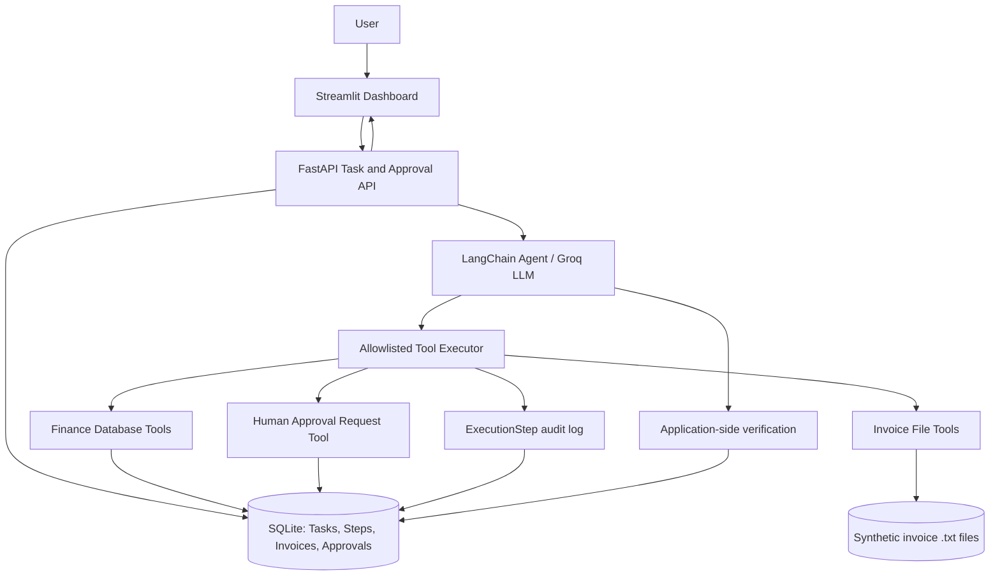

# WorkPilot — Architecture and Design Decisions

## 1. Purpose and scope

WorkPilot is a bounded autonomous AI task worker built for the CentrAlign AI Engineering Intern assignment. A user submits a natural-language request concerning invoices in a **synthetic local company environment**. The agent selects approved tools to locate an invoice, extract its fields, persist it to SQLite, verify the saved data, and request human authorization when necessary.

WorkPilot does **not** access real company finance systems, transmit payments, or autonomously approve payments. It currently works with structured text invoices in a controlled local directory.

## 2. High-level architecture



The LLM chooses which available tool to invoke; Python code performs and validates the action. Persistent state and execution evidence live in SQLite, not solely in the model conversation.

## 3. Main components

| Component | Location | Responsibility |
|---|---|---|
| API server | `app/main.py` | Task creation/execution, status and step retrieval, invoice lookup, approval decisions |
| Agent reasoning | `app/agent/reasoning.py` | Natural-language interpretation, tool selection, bounded execution, outcome verification |
| Tool executor | `app/agent/executor.py` | Allowed-tool dispatch, argument passing, step logging, safe retry on selected reads |
| Invoice tools | `app/tools/invoice_tools.py` | Find invoices and extract/validate structured fields |
| Finance tools | `app/tools/finance_tools.py` | Idempotent invoice save and read-back |
| Approval tools | `app/tools/approval_tools.py` | Generate pending human approval request |
| Persistence | `app/database.py`, `app/models.py` | SQLAlchemy models and SQLite session management |
| Dashboard | `frontend/dashboard.py` | Submit tasks, inspect execution history, review approval requests and metrics |
| Tests | `tests/` | Unit and API behavior, safety and retry checks |
| Benchmarks | `benchmarks/benchmark_agent.py` | Isolated end-to-end agent scenarios using temporary databases |

## 4. Agent lifecycle

The intended loop is **goal → understand → select tool → execute → observe → adapt → verify → report**.

1. The user enters a request through Streamlit or FastAPI.
2. FastAPI creates a persisted `Task`.
3. The Groq-backed LangChain agent receives the request and its allowlisted tools.
4. The agent chooses a tool and arguments. The executor dispatches the call and records an `ExecutionStep`.
5. The agent receives the tool result and decides what action to take next, subject to a bounded tool-call limit.
6. When an invoice is saved, the agent uses `get_invoice` to read it back and the application verifies key persisted values against extracted values.
7. The task transitions to a terminal or waiting state, for example `completed`, `needs_input`, `failed`, or `awaiting_approval`.
8. The dashboard displays results and recorded evidence rather than relying solely on a free-form LLM success claim.

### Example: standard invoice task

```mermaid
sequenceDiagram
    actor User
    participant API as FastAPI
    participant Agent as Groq/LangChain Agent
    participant Executor as Tool Executor
    participant Data as Invoice Files / SQLite
    User->>API: Submit invoice-processing request
    API->>Agent: Execute task
    Agent->>Executor: search_invoices(company)
    Executor->>Data: Inspect synthetic files
    Data-->>Executor: Matching invoice metadata
    Executor-->>Agent: Search result + logged step
    Agent->>Executor: extract_invoice_fields(filename)
    Executor-->>Agent: Validated fields
    Agent->>Executor: save_invoice(fields)
    Executor->>Data: Idempotent insert / retrieve existing
    Data-->>Executor: Stored invoice ID
    Agent->>Executor: get_invoice(invoice_id)
    Executor->>Data: Read back invoice
    Data-->>Executor: Persisted fields
    Executor-->>Agent: Stored fields
    Agent-->>API: Result; application checks verification evidence
    API-->>User: Status and execution history
```

## 5. Data model and state

- **Task:** request text, status, result, timestamp.
- **ExecutionStep:** task, step number, selected tool, input, output, error and status.
- **Invoice:** company, invoice number, dates, amount, currency, payment approval status. The company/invoice-number pair is unique.
- **ApprovalRequest:** associated task and invoice, requested action, pending/approved/rejected status and decision note.

Task status and invoice payment-approval status are **different**. A task may be `awaiting_approval` while the invoice remains `not_approved`. An approved request updates the local invoice's authorization state; it does **not** execute a payment.

## 6. Trust boundaries and human approval

The agent may request human approval but cannot supply the authorization credential or directly mark an invoice as approved. The FastAPI approval-decision route validates the secret in the `x-approval-token` header before applying a decision. The service checks that the approval is pending and that the associated task is awaiting approval. Database updates are performed transactionally to avoid partially applied decisions.

The model is restricted to an explicit tool allowlist. The executor provides the trusted `task_id` when it invokes the approval-request tool rather than accepting a model-selected task ID.

**Production caveat:** a shared token is only suitable for a local prototype. A deployed system would need per-user identity, role-based authorization, audit integrity, secret management, and stronger concurrency controls.

## 7. Reliability and recovery

- **Structured extraction validation:** required fields, ISO-style dates, positive amounts, valid date ordering, and safe file-name handling.
- **Idempotency:** saving the same company/invoice-number pair reuses the existing record instead of inserting a duplicate.
- **Independent verification:** the persisted invoice is read back and compared with the extracted data; an LLM assertion alone is insufficient.
- **Missing data:** a company with no matching invoice produces a `needs_input` outcome instead of inventing an invoice.
- **Bounded retry:** `get_invoice`, a read-only tool, retries a simulated SQLAlchemy `OperationalError` once (two attempts maximum). Writes and approvals are not automatically retried.
- **Retry evidence:** recovery events are included in the logged tool output for subsequent inspection.
- **Failure reporting:** executor exceptions are reflected in tool outcomes and step logs.

**Important limitation:** the tested retry mechanism handles a simulated transient read failure. It does not establish recovery from a genuinely disconnected database that requires session replacement or rollback between attempts. The retry decision is implemented in Python, not autonomously invented by the LLM.

## 8. Why this architecture?

### LLM planning with deterministic tools

The LLM handles the variable part—interpreting a request and choosing the next action—while Python tools handle persistence, validation and safety-sensitive decisions. This avoids treating model-generated prose as authoritative evidence of execution.

### A small, explicit tool allowlist

A limited tool surface reduces accidental actions and makes tool behavior observable, testable and auditable. New company integrations can be added behind the same executor pattern rather than granting unrestricted code or system access.

### SQLite and synthetic invoices

These support rapid local development, reproducible demonstrations and isolated benchmarks without external systems or sensitive company credentials. The trade-off is limited concurrency and no real inbox/PDF intake.

### Human-in-the-loop authorization

Invoices can be processed automatically while sensitive authorization remains a separate, explicit human action. This preserves a clear permissions boundary.

### Retrying only safe reads

A blind retry of a payment or non-idempotent write risks duplicating a side effect. Initially restricting retries to `get_invoice` is intentionally conservative; production retry policies should classify failures and account for transaction/session state.

## 9. Testing and evaluation evidence

Reported local results:

- **23 automated tests passed** (unit, API and recovery tests).
- **6/6 controlled benchmark scenarios passed** in the latest reported run:
  1. Normal invoice processing.
  2. Case-insensitive company request.
  3. Duplicate invoice protection.
  4. Unknown company handling.
  5. Human approval gate after invoice read-back verification.
  6. Transient database read failure followed by successful retry.

The benchmark uses separate temporary SQLite databases and synthetic input files. These figures describe the reported test runs, **not** a guarantee of production accuracy or robustness across repeated trials.

Reproduce with:

```powershell
python -m pytest tests/ -v
python -m benchmarks.benchmark_agent
```

## 10. Limitations and next steps

| Current limitation | Next improvement |
|---|---|
| Structured `.txt` invoice inputs only | PDF/image extraction with validation and secure ingestion |
| No automatic invoice collection | Controlled inbox or file-watcher connector with deduplication |
| Single-machine, synchronous prototype | Background task queue and workers |
| Basic transient-read retry | Error classification, transactional recovery and session recreation |
| Shared approval token | Authenticated users, roles and immutable audit events |
| Limited task domain | Reusable connector interfaces for additional company systems |
| Small, one-run benchmark | Repeated trials, fault injection, varied requests and statistical reporting |
| Local SQLite persistence | Production database, migrations, observability and concurrency controls |

## 11. Technical walkthrough talking points

Be prepared to demonstrate and explain:

1. A natural-language request that causes real database writes and a verified read-back.
2. An unknown company that produces `needs_input` instead of fabricated data.
3. A request that pauses at `awaiting_approval`, requiring a separate authorized human decision.
4. A synthetic transient read failure, a logged retry and successful task completion.
5. Why saving an invoice and approving payment are separate operations.
6. Why the demo uses a deterministic tool executor instead of granting the LLM direct database or shell access.
7. How you would expand input sources and scale beyond a local prototype.

## 12. Technology disclosure

- **Language/runtime:** Python.
- **API:** FastAPI.
- **Agent framework:** LangChain.
- **LLM provider/model:** Groq using `openai/gpt-oss-120b` (verify configured model in your local `.env` before submission).
- **Persistence:** SQLAlchemy with SQLite.
- **UI:** Streamlit.
- **Testing:** pytest and an isolated scenario benchmark.

Do not commit `.env`, secret tokens, credentials, private company records, or local SQLite data. Rotate any token previously exposed in shared logs.
